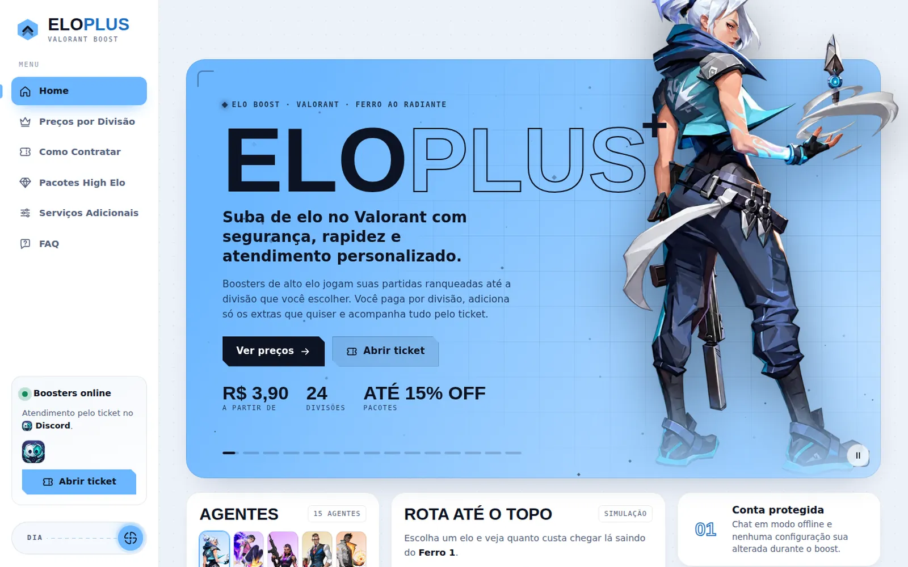

<p align="center">
  
</p>

<p align="center">
  
  
  
  
</p>

<p align="center">
  Site para um serviço voltado a jogadores de Valorant, com tabela de preços por divisão, calculadora de orçamento, pacotes, extras e uma experiência de ranks animada pela rolagem.
</p>

<p align="center">
  <a href="https://lorenzo-or7.github.io/eloplus-demo/"><b>🔗 Acessar o site</b></a>
</p>

---

## 🖥️ Preview

<p align="center">
  <a href="https://lorenzo-or7.github.io/eloplus-demo/"></a>
</p>

---

## 📌 Sobre o projeto

O site precisava falar a língua do jogador: visual de jogo, informações diretas e um orçamento que se monta sozinho. O destaque é a experiência de ranks, em que a rolagem leva o visitante do Ferro ao Radiante.

Azul-marinho e azul-céu com tipografia condensada (Big Shoulders Display), detalhes em fonte mono e quadros animados de cada rank.

---

## ✨ Funcionalidades

- 💲 Tabela de preços por divisão
- 🧮 Calculadora de orçamento: clique na linha e ela entra no pedido
- 📦 Pacotes High Elo
- ➕ Serviços adicionais com acréscimo calculado
- 🏆 Experiência de ranks animada pela rolagem
- 🧑‍🚀 Seleção de agentes
- ❓ Perguntas frequentes
- 🧭 Barra lateral de navegação
- 📱 Layout responsivo

---

## 🛠️ Tecnologias

- **HTML5** para a estrutura
- **CSS3** para identidade visual, responsividade e animações
- **JavaScript** puro para as interações
- **GitHub Pages** para hospedagem

Estrutura separada em `css/` e `js/`, com animação de ranks feita por quadros (frames) em WebP.

---

## ⚙️ Como rodar

Não precisa instalar nada: baixe o repositório e abra o arquivo `index.html` no navegador.

```bash
git clone https://github.com/lorenzo-or7/eloplus-demo.git
```

> Projeto independente, sem vínculo com a Riot Games. Valorant e as artes dos agentes são marcas e propriedades da Riot Games.

---

## 👨‍💻 Autor

<p>
  Feito por <b>Lorenzo Orsetti</b><br/>
  <a href="https://lorenzo-or7.github.io">
    
  </a>
  <a href="https://www.linkedin.com/in/lorenzo-orsetti-031906349/">
    
  </a>
  <a href="https://github.com/lorenzo-or7">
    
  </a>
</p>

<p align="center">
  
</p>
